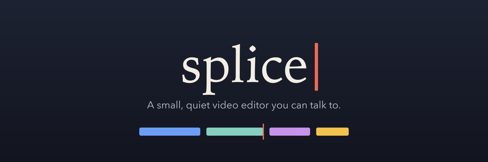
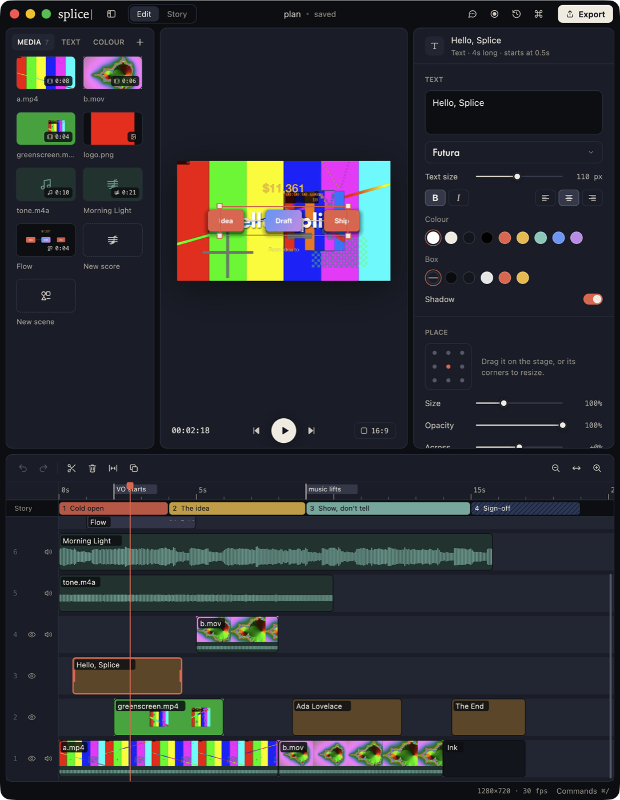
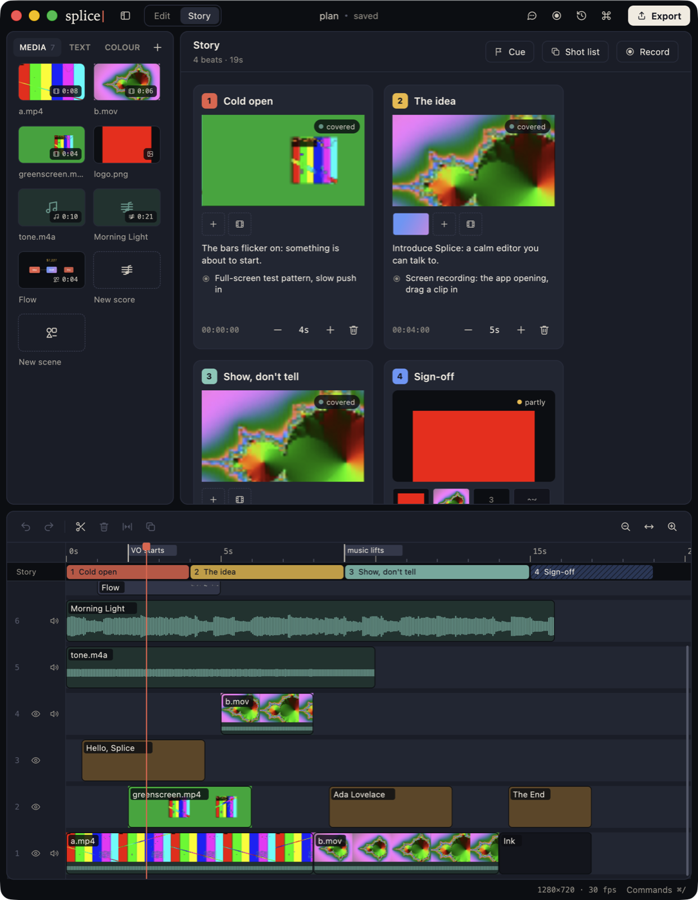
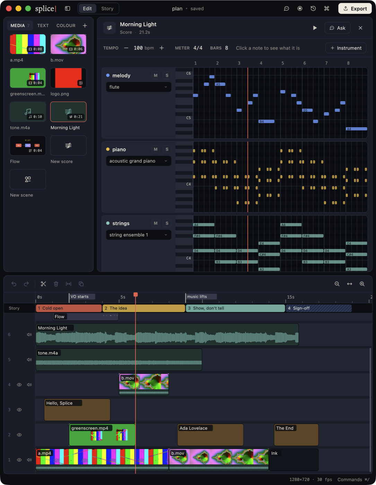

<p align="center">
  
</p>

<p align="center">
  <b>A small, quiet video editor you can talk to.</b><br>
  Rust core · GPU-rendered · titles, looks, music and motion made in place · a story board · screen recording · an assistant that edits beside you
</p>

<p align="center">
  <a href="https://github.com/ArchAstro/splice/releases/latest"></a>
  <a href="https://github.com/ArchAstro/splice/actions/workflows/ci.yml"></a>
  
  
  <a href="LICENSE"></a>
</p>

<p align="center">
  <a href="#install">Install</a> ·
  <a href="#using-it">Using it</a> ·
  <a href="#titles-and-looks">Looks</a> ·
  <a href="#scores-and-scenes">Music and scenes</a> ·
  <a href="#story-and-recording">Story</a> ·
  <a href="#assistants">Assistants</a>
</p>

<p align="center">
  
</p>

To *splice* film is to join two pieces of it: cut, line up, tape. Splice keeps
editing that simple. CapCut is the inspiration and simplicity the rule: bring
in videos, images and sound, layer them on a timeline, cut, play, export.

## Why Splice

1. **It stays out of the way.** Media on the left, the picture in the middle,
   settings on the right, the timeline below. Everything is one click or one
   key, and every change is one undo step.
2. **It makes what you would otherwise fetch.** Titles in any installed font,
   colour cards, green screen, masks and motion; music written as a score and
   played with real instruments; animated diagrams drawn from a short
   description. No plug-ins, no second app.
3. **It plans as well as cuts.** A story board of beats, shots and reference
   pictures sits on the same timeline as the footage, and the screen recorder
   drops takes straight into the beat they are for.
4. **Assistants work beside you.** `splice ctl` lets Claude, or any program,
   read the project, edit it, compose its music, look at any frame and record
   the screen, while you keep working. A project is one file, autosaved and
   versioned.

<p align="center">
  
  
</p>

## Install

```sh
curl -fsSL https://raw.githubusercontent.com/ArchAstro/splice/main/install.sh | sh
```

This downloads the latest release for macOS 13+ (Apple Silicon or Intel),
checks it against the published checksums, installs `Splice.app` into
`/Applications` with the `splice` command in `~/.local/bin` (the same program),
the Claude Code skill in `~/.claude/skills/splice`, and ffmpeg with Homebrew if
it is missing. `SPLICE_VERSION=v0.1.0`, `SPLICE_INSTALL_DIR`, `SPLICE_APP=0`
(the command only), `SPLICE_FFMPEG=0` and `SPLICE_SKILL=0` change that.

You can also download `splice-macos.dmg` from the releases page and drag the
app across. Until releases are signed with a Developer ID, an app downloaded in
a browser needs a right-click → Open the first time; the installer does not.

To build from source instead (needs Rust 1.90+ and `brew install ffmpeg`):

```sh
gh repo clone ArchAstro/splice && cd splice
make install       # builds splice into ~/.cargo/bin and links the skill
make run           # or run it straight from the checkout
make install-app   # Splice.app in /Applications
```

## Using it

- **Import**: ⌘I, the Import button, or drop files from Finder anywhere on the
  window. Drop them on the timeline to place them where they land.
- **Arrange**: drag media from the bin onto the timeline. Drag clips to move
  them in time or between layers, and drag above the top layer to make a new
  one. Higher layers draw over lower ones. Clips snap to edges and the
  playhead; hold ⌥ to move freely.
- **Trim**: drag either end of a clip.
- **Cut**: S or ⌘B splits the selection at the playhead, or every clip under
  it if nothing is selected. ⌫ deletes, ⇧⌫ ripple-deletes (closes the gap),
  ⌘D duplicates.
- **Play**: Space plays and pauses. ← → step one frame, ⇧← ⇧→ (or J, L) one
  second. Click or drag the ruler to scrub.
- **Layers**: each track's gutter toggles *visible / hidden* and
  *sound / muted* (H and M act on the selection's tracks).
- **Canvas**: the first clip sets the canvas shape. The shape button cycles
  16:9, 9:16, 1:1 and 4:5.
- **Export**: ⌘E (H.264 + AAC MP4), or ⇧⌘E for a fast draft.
- **Everything else**: ⌘/ opens the command menu, with every command and its key.

## Titles and looks

- **Text** (⌘T, or the Text shelf): titles in any installed font, with size,
  bold, italic, alignment, colour, a box behind and a soft shadow. Type in the
  inspector, or double-click a title on the stage.
- **Colour** shelf: full-frame colours for backgrounds and title cards, and a
  half-black tint.
- **Inspector** (⌘2), for the selected clip:
  - **Place:** drag a picture on the stage, or its corners to resize. It snaps
    to the centre lines. There's a nine-point grid, plus size, opacity and
    position sliders.
  - **Animate:** in and out with fade, slide (four ways), zoom or pop, with a
    length you choose. A slow zoom can run across the whole clip.
  - **Green screen:** key out green or blue, with strength, softness and fringe
    clean-up.
  - **Mask:** circle or box, with size, position, feather and invert.
  - **Sound:** volume.

The viewer and export share one renderer, so what you see is what you get.
Titles are drawn once in Rust (cosmic-text) and that same picture is overlaid
on export. Keys and masks are ffmpeg filters that the viewer's decoder runs
too. Animation is one expression, evaluated for the viewer and printed into
ffmpeg for export.

## Scores and scenes

Two kinds of media Splice makes rather than imports. Each opens in its own
editor (double-click it in the media panel or on the timeline, or use the
**New score** / **New scene** tiles), and each re-renders when it changes,
with every clip of it following.

- **Score**: music as notes. Instruments, tempo, meter and notes in beats,
  shown as a piano roll with one lane per instrument. Click to add a note,
  drag to move or lengthen it, ⌫ to delete. Each lane has mute, solo and an
  instrument picker covering the 128 General MIDI instruments plus a drum kit.
  It plays with the timeline, so you hear it against the picture. Splice
  renders it with rustysynth and the GeneralUser GS SoundFont, which it
  downloads once (32 MB) and checks. The assistant can compose it from JSON
  (the same shape as Clapper's scores); **Ask** in the editor sends it what
  you have open.
- **Scene**: an animation or diagram described as JSON: layers of rects,
  ellipses, lines, SVG paths, text and groups, with keyframes, eases,
  springs, staggered entrances and exits, outlines that draw themselves,
  typed and counted text, gradients, soft shadows and a camera. Splice
  paints every frame itself, with tiny-skia for shapes and cosmic-text for
  words. It encodes to ProRes 4444 with a transparent background by default,
  so a scene overlays what is under it, and a 5 s scene renders in about a
  second. The editor shows the JSON with syntax colours (and a swatch by
  each colour) beside the picture. **Edit** opens the file in your text
  editor, and every save re-renders it.

Renders are cached by what they are made from, and kept in the project file
so it still opens anywhere.

## Story and recording

**Story** (⌘3, or Edit / Story in the title bar) plans the movie before and
while you cut it.

- **Beats** run end to end from the start of the timeline. Each one has a
  title, what happens, what to capture, and a length.
- The **Story board** shows the beats as cards, each with a frame of its
  footage or a "to capture" panel and a covered / partly / empty badge.
  - Double-click any text to type in it; Tab moves to the next field.
  - Drag cards to reorder them.
  - Drop media on a card to lay it into that beat.
- The timeline gets a **story lane** under the ruler. Each beat shows in its
  own colour, hatched where it still needs footage. Drag a beat's end to
  lengthen it.
- **Footage belongs to the beat it starts in.** Reordering, resizing or
  removing beats carries the footage along. Removing a beat never deletes
  footage.
- **Reference shots:** each beat can hold any number, each a picture of what
  a shot should look like, with a note.
  - Ways to add them:
    - drop image or video files from Finder on a card
    - paste a screenshot with ⌘V (⌃⇧⌘4 copies one)
    - grab the viewer's current frame
    - pick files with +
  - They show as a strip on the card; click one to see it large.
  - Until a beat has footage, its first reference stands in for the picture.
  - They are kept in the project file, out of the media panel.
- **Cues** (C) mark moments on the ruler, such as "VO starts" or "music
  lifts".
- **Shot list** copies the plan as text.
- Keys: B adds a beat, C marks a cue.

**Record** (⇧⌘R, or the record button) captures the screen with macOS's own
recorder, so there is no OBS and no extra install.

- You can record the entire screen or any one window, with the cursor and
  optional clicks and microphone.
- Recording the whole screen hides Splice. Click it in the Dock to stop.
- The take comes into the media panel. In Story view it goes into the chosen
  beat instead.
- The first recording asks for Screen Recording permission. It is granted to
  whatever launched Splice: the app, or your terminal.

## Projects

A project is one `.splice` file: a SQLite database holding the imported
media and every version of the timeline. Copy it anywhere and it opens with
its media intact.

- **Autosave**: every change is written within two seconds. New projects
  start as `~/Movies/Splice/Untitled N.splice`; ⌘S on one asks where to keep it.
- **Versions**: autosaves and saves (⌘S) are both kept in the file. ⇧⌘H
  lists them, and restoring one is an ordinary edit, so ⌘Z takes it back.
- **Formats are versioned**: the file records its format version and the
  project JSON its schema, and both have upgrade hooks.

Headless, for scripts:

```sh
splice --new film.splice a.mp4 b.png c.m4a   # media end to end
splice --info film.splice
splice --export film.splice film.mp4 [--draft]
```

## Assistants

Other programs work in the open project through `splice ctl` while you edit,
after Stet's `stet ctl`. The included skill (`skill/splice/SKILL.md`, installed
with `make install-skill`) teaches Claude Code to use it.

| Command | Does |
|---|---|
| `splice ctl status` / `read` | the project; every track and clip with ids and times |
| `splice ctl frame [T] out.png` | the picture at time T, drawn as export draws it |
| `splice ctl import FILES [--at T]` | brings media in, optionally onto the timeline |
| `splice ctl add / move / trim / split / delete / duplicate / volume` | timeline edits, each one undo step |
| `splice ctl track`, `canvas`, `undo`, `redo` | layers, canvas shape, history |
| `splice ctl text`, `color`, `style`, `fonts` | titles in system fonts, colour cards and tints |
| `splice ctl look` | position, size, opacity, animation, green screen, mask |
| `splice ctl score new / read / write / instruments` | compose music: a score as JSON |
| `splice ctl scene new / read / write / help` | animations and diagrams, described as JSON |
| `splice ctl scene sheet / frame / patch / add / remove / check` | see a scene's motion as a contact sheet; edit layers by name; validate first |
| `splice ctl open --media M` | opens a score or scene in its editor |
| `splice ctl seek`, `play`, `pause`, `select`, `command` | the playhead, selection and any menu command |
| `splice ctl save`, `versions`, `export FILE [--wait]` | versions and export |
| `splice ctl ui`, `click`, `hover`, `drag`, `scroll`, `key`, `type` | operate the window as a person would, for checking the interface |
| `splice ctl story read / add / set / move / remove / fill / list / shot`, `cue add / set / remove`, `view edit|story` | plan the movie: beats and cues |
| `splice ctl record sources / start / stop / status` | record a screen, a window or a region, into a beat or the timeline |
| `splice ctl wait --name Claude` | connects an assistant and waits for your message |
| `splice ctl say --text T` | shows a line in the status bar |

While an assistant waits, the title bar shows `● Claude`; press ⇧⌘A (or click
it) to send a message. Your playhead and selected clips travel with it, so
"tighten this clip" means the one you selected. Each window
listens on its own socket in `~/Library/Application Support/Splice/ctl/`, and
only your user can connect. With one window open, commands go to it; with
several, name the project: `splice ctl --project demo status`, or set
`SPLICE_PROJECT` once for a session.

## Contributing

See [CONTRIBUTING.md](CONTRIBUTING.md). Security reports go through
[SECURITY.md](SECURITY.md), not issues. Splice is MIT licensed.

## Layout

| Crate | Owns |
|---|---|
| `crates/splice-core` | timeline model and edits, undo, the `.splice` file, export plans. No platform code. |
| `crates/splice-app` | GPUI window, bin, viewer, timeline, ffmpeg decoding, playback, sound (cpal) |

Decoding and export run ffmpeg as a child process. A bad file can't crash the
editor, and codec support is whatever your ffmpeg has.
